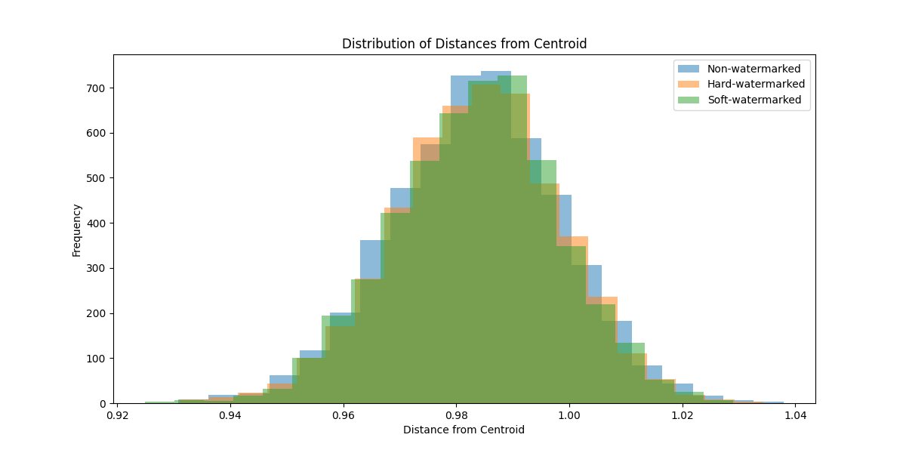
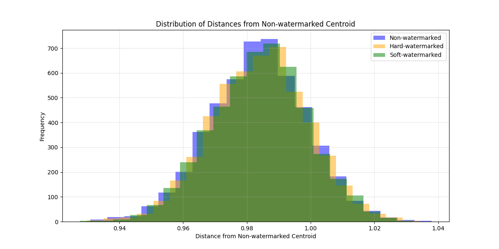

# 🔍 Assessing Text Integrity: Evaluating the Effect of Watermarking in LLMs

A research project investigating whether LLM watermarking techniques degrade the semantic quality of generated text, using centroid-based embedding analysis across 15,000 generated samples.

Conducted as **APPS597 Supervised Independent Study** during the Master of Applied Science in Artificial Intelligence at the University of Otago, New Zealand.

**Supervisor:** Andrew Trotman, Associate Professor, University of Otago

---

## ⚠️ Status and known limitations

This section describes what the code in this repository actually does. Read the results below with it in mind.

- **The watermark does not change the generated text.** In `generate_text_with_watermark` (`watermarking.py`), the full response is first collected from Ollama. The code then creates a separate random vector (`np.random.rand(50000)`), applies the hard or soft green/red-list rule to that vector, takes its argmax, and appends `" [Token ID: <id>]"` to the text. The tokens the model produced are never modified.
- **What the results therefore measure.** In all three conditions the text is generated the same way: five independent Ollama samples per prompt. The reported numbers describe the baseline sampling variation of this pipeline. They are not evidence about the effect of watermarking on text quality.
- **Only watermarked outputs get the suffix.** Non-watermarked outputs have nothing appended. The token list generator reseeds NumPy's global RNG with 42 on every call, so the "random" vector is the same every time after the first call. As a result the suffix is effectively constant: `[Token ID: 24782]` in all 5,000 soft rows and in 4,999 of 5,000 hard rows (the first hard row has 26112). This suffix is the only systematic text difference between the conditions.
- **The green/red lists come from a fixed seed.** The vocabulary is shuffled once with `np.random.seed(42)` and split at γ = 0.5, giving the same partition every time. No secret key or previous token is hashed. `sha256` is imported but not used.
- **The length limit is ignored.** The request sends `"max_length": 50` as a top-level field. Ollama reads the limit from `options.num_predict`, so no limit was applied. Median output length is about 157–161 words per condition, and the longest output is 4,853 words.
- **There is no detector.** The repository has no z-score or other watermark detection step, so detectability was not measured.
- **The prompt sample is unseeded.** `collection_data.sample(1000)` has no `random_state`. The same 1,000 prompts were used for all three conditions within the run, but the exact sample cannot be reproduced.
- **Unused code.** `BATCH_SIZE` and `process_dataset` are defined in `watermarking.py` but not used by the main workflow.
- **Scope.** The experiment was run within the available compute and time (about 72 hours of GPU time for 15,000 generations) with LLaMA 3.1 8B only.

See [Corrected design (future work)](#-corrected-design-future-work) for how the experiment would need to change to test the research questions.

---

## 📌 What This Project Does

The rapid adoption of large language models has raised concerns about misuse — AI-driven misinformation, academic dishonesty, and copyright violation. Watermarking offers a solution by embedding detectable signals into LLM outputs. But does watermarking change the meaning of the generated text?

This project applies two watermarking schemes based on Kirchenbauer et al.'s work to the LLaMA 3.1 8B model, then measures their impact on text quality using semantic similarity and centroid distance analysis across the MS MARCO dataset.

**Research questions:**
1. Do watermarking techniques degrade the semantic quality of LLM outputs?
2. How do hard and soft watermarking compare in practice?

---

## 🔬 Watermarking Techniques

Both techniques partition the vocabulary into "green" and "red" token lists. In Kirchenbauer et al., the green list is re-derived at each decoding step by hashing the previous token with a secret key. This implementation instead uses one fixed partition from `np.random.seed(42)`. Green list ratio (γ) is set to 0.5.

**Hard Watermarking** — sets the logits of red-list tokens to negative infinity, so they cannot be selected.

**Soft Watermarking** — adds a delta value (δ = 2.0) to the logits of green-list tokens, biasing selection without blocking any token.

In this code both rules are applied to a simulated logit vector after generation, not to the model's logits (see [Status and known limitations](#️-status-and-known-limitations)).

---

## 🧪 Experiment Design

- **Dataset:** MS MARCO — 1,000 random passages sampled from 8 million
- **Model:** LLaMA 3.1 8B via Ollama API (a 50-token limit was intended but not applied; see limitations above)
- **Samples:** 1,000 prompts × 5 responses × 3 conditions = **15,000 total samples** (5,000 rows per condition CSV)
- **Embeddings:** `all-MiniLM-L6-v2` (SentenceTransformers)
- **GPU:** CUDA acceleration via PyTorch
- **Distance metric:** Euclidean distance from centroid

Three phases were run on the same 1,000 prompts: non-watermarked (baseline), hard-watermarked, and soft-watermarked. For each prompt, the centroid of its 5 embeddings was calculated, and each sample's Euclidean distance from that centroid was measured.

---

## 📊 Results

### Distance from centroid

| Metric | Non-watermarked | Hard-watermarked | Soft-watermarked |
|---|---|---|---|
| Mean distance | 0.9835 | 0.9837 | 0.9835 |
| Standard deviation | 0.0151 | 0.0146 | **0.0145** |
| Maximum distance | 1.0379 | 1.0344 | **1.0290** |
| Minimum distance | 0.9309 | 0.9311 | 0.9250 |
| Results above mean | 1,519 | 1,566 | 1,567 |
| Results below mean | 1,526 | 1,506 | 1,513 |
| Results near mean | 1,955 | 1,928 | 1,920 |

The three conditions show near-identical distributions (mean 0.9835–0.9837), as expected given the limitation above: the model output is generated the same way in all three. The soft-watermarked condition has the smallest standard deviation and maximum distance, but the differences are small, were not tested for significance, and do not reflect a watermark effect.

### Figure 1 — Distribution of distances from each system's own centroid



All three conditions show near-identical bell-shaped distributions peaking at 0.98–0.99. This is consistent with all three being samples from the same, unmodified generation process.

### Figure 2 — Distribution of distances from the non-watermarked centroid



When all three conditions are measured against the same non-watermarked centroid, the distributions still overlap substantially, as expected given the limitation above.

### Inter-system centroid distances

| Comparison | Centroid distance |
|---|---|
| Non-watermarked → Hard-watermarked | 0.0313 |
| Non-watermarked → Soft-watermarked | 0.0304 |
| Hard-watermarked → Soft-watermarked | **0.0085** |

The two watermarked conditions are each about 0.03 from the non-watermarked centroid and 0.0085 from each other. Only the watermarked outputs carry the appended `[Token ID: 24782]` suffix, so this pattern is consistent with the suffix shifting the embeddings rather than with any watermark effect. No significance test was run.

### Key findings

- The three conditions show near-identical distance distributions (mean 0.9835–0.9837, standard deviation 0.0145–0.0151), as expected given that the watermark does not alter the generated text
- The soft-watermarked condition has a slightly smaller standard deviation (0.0145 vs 0.0151) and maximum distance (1.0290 vs 1.0379) than the baseline; these differences are small, untested, and should not be read as one scheme performing better
- The ~0.03 centroid shift of the watermarked conditions is consistent with the appended token ID suffix
- No detector was implemented, so these results say nothing about watermark detectability, and they are not evidence about the effect of watermarking on text quality
- The run took about 72 hours of GPU time for 15,000 generations

---

## 🛠️ Tech Stack

| Component | Tool |
|---|---|
| LLM | [Ollama](https://ollama.com) + LLaMA 3.1 8B |
| Embeddings | SentenceTransformers (`all-MiniLM-L6-v2`) |
| Data processing | pandas, numpy |
| Distance metrics | scipy |
| Visualisation | matplotlib |
| GPU acceleration | PyTorch + CUDA |
| Dataset | MS MARCO |

---

## ✅ Prerequisites

- Python 3.10+
- [Ollama](https://ollama.com) installed and running
- Conda (recommended for environment management)
- MS MARCO `collection.tsv` file

---

## 🚀 Setup and Usage

**1. Create and activate a conda environment**

```bash
conda create --name watermarking
conda activate watermarking
```

**2. Install dependencies**

```bash
pip install requests numpy transformers sentence-transformers pandas scipy matplotlib torch
```

**3. Install Ollama and pull the model**

```bash
# Install from https://ollama.com then pull the model
ollama pull llama3.1:8b
ollama serve          # leave running in a separate terminal
```

**4. Run the main experiment**

Generates 15,000 text samples (1,000 prompts × 5 samples × 3 conditions) and saves them to CSV:

```bash
python watermarking.py
```

**5. Analyse results**

Computes distance statistics and plots distribution of distances from each system's own centroid:

```bash
python analysis.py
```

Plots distribution of distances from the non-watermarked centroid for all three systems:

```bash
python compute.py
```

**6. Deactivate the environment when done**

```bash
conda deactivate
```

---

## 📁 Project Structure

```
Watermarking-on-LLMs/
├── watermarking.py                    # Main experiment — generates all 15,000 samples
├── analysis.py                        # Computes centroid stats + inter-system distances
├── compute.py                         # Plots distances from non-watermarked centroid
├── collection.tsv                     # MS MARCO dataset (not included, download separately)
├── results/
│   ├── non_watermarked_results.csv        # Baseline outputs + embeddings
│   ├── hard_watermarked_results.csv       # Hard watermarked outputs + embeddings
│   ├── soft_watermarked_results.csv       # Soft watermarked outputs + embeddings
│   ├── hard_watermarked_with_centroid.csv # Manually derived from hard results for report analysis
│   └── soft_watermarked_with_centroid.csv # Manually derived from soft results for report analysis
├── Analysis.png                       # Distribution of distances from each system's centroid (Figure 1)
├── Figure_1.png                       # Distribution of distances from non-watermarked centroid (Figure 2)
└── README.md
```

**Primary result CSVs** (generated by `watermarking.py`):

| Column | Description |
|---|---|
| `id` | Prompt identifier from MS MARCO |
| `prompt` | The original input passage |
| `generated_text` | LLM response (with token ID appended for watermarked outputs) |
| `distance_from_centroid` | Euclidean distance from the prompt's 5-sample centroid |
| `semantic_similarity` | Cosine similarity between prompt and response embeddings |
| `embedding` | Full 384-dimensional embedding vector (JSON) |

**Centroid CSVs** (manually derived from the primary results for report analysis):

| Column | Description |
|---|---|
| `id` | Prompt identifier |
| `prompt` | The original input passage |
| `watermarked_text` | The watermarked generated text |
| `semantic_similarity` | Cosine similarity between prompt and response |
| `centroid` | Mean embedding vector across all responses for that prompt |
| `distance_from_centroid` | Euclidean distance from the computed centroid |

---

## ⚠️ Known Limitations

- Experiment limited to 1,000 prompts per condition due to GPU constraints (72 hours runtime)
- LLaMA 3.1 8B only — larger models (70B, 405B) not tested
- Robustness against attacks (paraphrasing, text manipulation) not evaluated
- Watermarking logic applied post-generation via logit modification rather than integrated into the model's decoding loop

---

## 🧭 Corrected design (future work)

To test whether watermarking affects text quality, the experiment would need these changes:

1. **Apply the watermark inside the decoding loop.** Generate with Hugging Face `transformers` and implement the watermark as a `LogitsProcessor`, so the model's logits are modified at every step before the next token is sampled. Ollama's generate API does not provide a way to modify logits during decoding.
2. **Derive the green list per step.** Seed the green/red split at each step from a hash (e.g. SHA-256) of a secret key and the previous token ID, as in Kirchenbauer et al.
3. **Add a z-score detector.** For a text of T scored tokens, recompute each step's green list with the key and count green tokens |s|_G. Then compute z = (|s|_G − γT) / √(Tγ(1 − γ)).
4. **Include a positive control.** Watermarked text must score high (e.g. z > 4) and unwatermarked text near zero. If it does not, the watermark is not being applied and the quality results cannot be interpreted.
5. **Make runs reproducible.** Set a real length limit (`max_new_tokens`), and seed both the prompt sample and generation.
6. **Measure quality directly.** Compute the perplexity of each output under a larger reference model. Also compute the semantic similarity between each watermarked output and the unwatermarked output for the same prompt and seed.
7. **Report paired differences.** Compare conditions per prompt and report the mean paired difference with confidence intervals (e.g. bootstrap 95% CIs).

---

## 🔭 Future Work

- Distributed GPU clusters for larger dataset processing
- Robustness testing against paraphrasing and mixing attacks
- Model scaling experiments with LLaMA 3.1 70B and 405B
- Integration of watermarking directly into the decoding loop
- Standardised benchmarking framework for watermark quality metrics

---

## 📄 Based On

> J. Kirchenbauer, J. Geiping, Y. Wen, J. Katz, I. Miers, and T. Goldstein, "A Watermark for Large Language Models," arXiv:2301.10226, 2023.

---

## 👤 Author

**Sooraj Srinivasa Babu**

Master of Applied Science in Artificial Intelligence, University of Otago, New Zealand

[LinkedIn](https://linkedin.com/in/soorajsrinivasababu)
